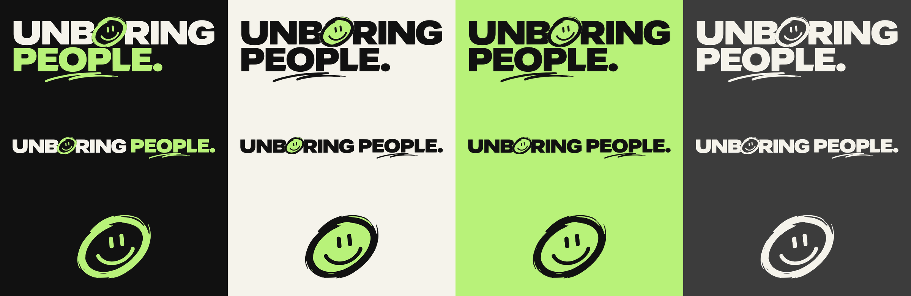

# UNBORING PEOPLE: brand design reference

## The logo

Rebuilt as a vector from the original artwork (`Logo/Source/unboring-people-original.webp`). The letters and the
hand-drawn marks were traced at 4× resolution, so the SVGs scale to any size, from a favicon to a billboard, with the
original letterforms and brush texture intact.

It has three parts:
- **The wordmark:** UNBORING over PEOPLE.
- **The smiley O:** a hand-drawn ring with a face, standing in for the O in UNBORING.
- **The underline:** two brush strokes under PEO.

### Layouts

| Layout | Use it for |
|---|---|
| `stacked` | The default. Website header, decks, print, anything with room. |
| `horizontal` | Wide, short spaces: footers, email signatures, banners, merch strips. |
| `mark` | Small or square spaces: avatars, favicons, stickers, watermarks. Only once the name is already known nearby. |

### Colour versions

| File suffix | Ground | Wordmark | Accent |
|---|---|---|---|
| `on-dark` | Ink or any dark photo | Warm White + Acid Lime | Lime ring and underline |
| `on-light` | Warm White, white, light photos | Ink | Ink ring on a solid lime disc, ink underline |
| `mono-ink` | Acid Lime, or one-colour print | Ink | Ink |
| `mono-paper` | Dark photos, embossing, one-colour on dark | Warm White | Warm White |

`SVG/` and `PNG/` are transparent. `with-background/` has the ground baked in, for decks, socials and anywhere
transparency breaks. PNGs are 4000px (stacked), 6000px (horizontal) and 2048px (mark) wide.

`Social/` has a 1080×1080 avatar (the mark on ink, safe inside Instagram's circle crop) and a 1500×500 banner.

**Why the light version is different:** lime on Warm White is too faint (about 1.3:1). The smiley disappears and the
logo reads "UNB RING". On light grounds, lime is used the way the website uses it: as a solid highlight behind ink.

### Rules

- **Clear space:** keep at least the height of the smiley O empty on every side.
- **Minimum size:** stacked 120px wide on screen (30mm in print), horizontal 200px (50mm), mark 24px (6mm).
- **Use only the files provided.** Don't recolour, stretch, rotate, add shadows or outlines, or re-type the wordmark in another font.
- **Don't put `on-dark` on light grounds, or `on-light` on dark ones.** Use `mono-ink` or `mono-paper` if neither fits.
- **The lime is Acid Lime `#B8F279`**, not the slightly yellower lime in the original artwork, so the logo matches the website and every other brand asset.

## Colours

| Name | Hex | Use |
|---|---|---|
| Ink Black | `#111111` | Main ground and text |
| Acid Lime | `#B8F279` | The one accent: highlights, buttons, the smiley. Never as text on Warm White. |
| Warm White | `#F5F3EB` | Paper ground |
| Concrete Grey | `#777777` | Secondary text on dark, large sizes only |

## Type

- **Archivo Black:** display headlines, uppercase, tight.
- **Space Grotesk:** labels, numbers, UI.
- **DM Sans:** body text.

The logo's letters are artwork, not a font. Never re-type "UNBORING PEOPLE" to stand in for the logo.

## Regenerating

`Logo/Source/traced-paths.json` holds the master vector paths. The scripts in `Logo/Source/tools/` rebuild every file:
`masks.py` splits the original into colour layers, `trace.cjs` vectorises them (potrace), and `variants.cjs` writes all
SVG and PNG versions. To add a colour version, add a scheme to `variants.cjs` and re-run it.
